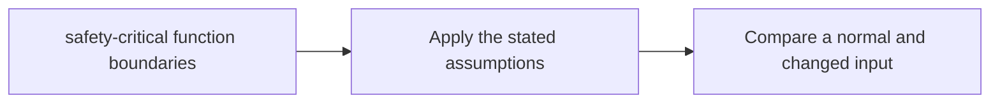

# A19.27 · safety-critical function boundaries

[A19.26](A19.26.md) · Principal · [A19.28](A19.28.md)

## Problem

An assistant is put on a safety-critical command path.

## Mechanism

Identify safety-critical functions independently of voice and keep qualified, bounded control channels for them. A local voice fixture exposes only benign allowlisted actions.



## Worked example

One benign query and one safety-critical control are requested; only the benign query is eligible.

Read the [executable calculation](../examples/A19.27.py) after predicting both outcomes.

```sh
uv run --locked python "01-architecture-A01-to-A20/A19-voice-multimodal-edge-embedded-ai/examples/A19.27.py"
uv run --locked python "01-architecture-A01-to-A20/A19-voice-multimodal-edge-embedded-ai/examples/A19.27.py" --break
```

Expected outputs are `1` and `2` respectively. Record the changed input, formula or invariant and restore the original control.

## Check your reasoning

1. What assumption is violated in the opening problem?
2. Compute the first result without running the file.
3. Identify the first observable difference in the alternate run.
4. State one change to the input that would exercise the boundary more sharply.
5. What operational separation prevents microphone input from becoming control authority?

<details>
<summary>Feedback</summary>

Compare the opening failure with the mechanism above. The observed results are `1` and `2`. Check the derivation against the worked example. For your additional boundary case, write the expected behavior before executing it. For the transfer question, name the policy, invariant or measurable assumption the decision depends on and identify evidence that would falsify it.

</details>

Compare the first decisive intermediate observation before changing the fixture. Use [L4](../labs/L4.md) for phase-level practice.

## Primary source

- [Reference for safety-critical function boundaries](https://treaties.un.org/doc/Publication/MTDSG/Volume%20I/Chapter%20XI/XI-B-16-156.en.pdf)
