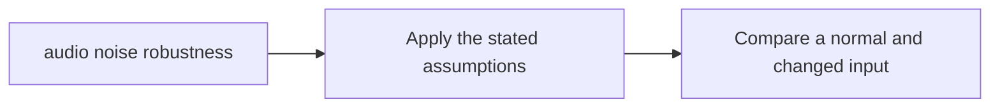

# A19.28 · audio noise robustness

[A19.27](A19.27.md) · Principal · [A19.29](A19.29.md)

## Problem

A model fares well on clean speech but fails in background noise.

## Mechanism

Compare cohorts using a fixed reference corpus and report signal-to-noise conditions and errors by noise class. Keep clean and noisy denominators visible.



## Worked example

Four clean errors in 100 words and 14 noisy errors in 100 give 10 percentage points difference.

Read the [executable calculation](../examples/A19.28.py) after predicting both outcomes.

```sh
uv run --locked python "01-architecture-A01-to-A20/A19-voice-multimodal-edge-embedded-ai/examples/A19.28.py"
uv run --locked python "01-architecture-A01-to-A20/A19-voice-multimodal-edge-embedded-ai/examples/A19.28.py" --break
```

Expected outputs are `0.1` and `0.04` respectively. Record the changed input, formula or invariant and restore the original control.

## Check your reasoning

1. What assumption is violated in the opening problem?
2. Compute the first result without running the file.
3. Identify the first observable difference in the alternate run.
4. State one change to the input that would exercise the boundary more sharply.
5. How do device position and echo affect the noise mix?

<details>
<summary>Feedback</summary>

Compare the opening failure with the mechanism above. The observed results are `0.1` and `0.04`. Check the derivation against the worked example. For your additional boundary case, write the expected behavior before executing it. For the transfer question, name the policy, invariant or measurable assumption the decision depends on and identify evidence that would falsify it.

</details>

Compare the first decisive intermediate observation before changing the fixture. Use [L4](../labs/L4.md) for phase-level practice.

## Primary source

- [Reference for audio noise robustness](https://docs.scipy.org/doc/scipy/reference/signal.html)
