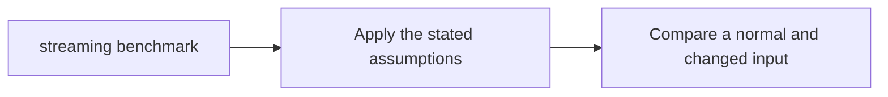

# A19.29 · streaming benchmark

[A19.28](A19.28.md) · Principal · [A19.30](A19.30.md)

## Problem

A streaming benchmark reports only mean completion time.

## Mechanism

For repeatable audio, measure first partial, first final and end-to-end times with explicit start events and overlap. Record revises and empty trials.



## Worked example

Events at 90,200,410 ms give first partial 90, first final 200 and completion 410.

Read the [executable calculation](../examples/A19.29.py) after predicting both outcomes.

```sh
uv run --locked python "01-architecture-A01-to-A20/A19-voice-multimodal-edge-embedded-ai/examples/A19.29.py"
uv run --locked python "01-architecture-A01-to-A20/A19-voice-multimodal-edge-embedded-ai/examples/A19.29.py" --break
```

Expected outputs are `(90, 200, 410)` and `(410, 410, 410)` respectively. Record the changed input, formula or invariant and restore the original control.

## Check your reasoning

1. What assumption is violated in the opening problem?
2. Compute the first result without running the file.
3. Identify the first observable difference in the alternate run.
4. State one change to the input that would exercise the boundary more sharply.
5. How would dropped or nondelivered events enter the metrics?

<details>
<summary>Feedback</summary>

Compare the opening failure with the mechanism above. The observed results are `(90, 200, 410)` and `(410, 410, 410)`. Check the derivation against the worked example. For your additional boundary case, write the expected behavior before executing it. For the transfer question, name the policy, invariant or measurable assumption the decision depends on and identify evidence that would falsify it.

</details>

Compare the first decisive intermediate observation before changing the fixture. Use [L4](../labs/L4.md) for phase-level practice.

## Primary source

- [Reference for streaming benchmark](https://learn.microsoft.com/en-us/azure/ai-services/speech-service/overview)
