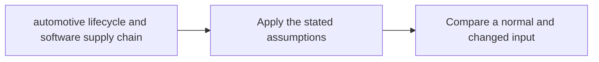

# A19.30 · automotive lifecycle and software supply chain

[A19.29](A19.29.md) · Principal · [A19.31](A19.31.md)

## Problem

A release record lacks traceability between code and a vehicle image.

## Mechanism

Automotive development divides software update management, cybersecurity and functional safety responsibilities. Verify applicable standards and supplier evidence for each product context.



## Worked example

Of four fixture software components, three link to versioned evidence. One lacks traceability.

Read the [executable calculation](../examples/A19.30.py) after predicting both outcomes.

```sh
uv run --locked python "01-architecture-A01-to-A20/A19-voice-multimodal-edge-embedded-ai/examples/A19.30.py"
uv run --locked python "01-architecture-A01-to-A20/A19-voice-multimodal-edge-embedded-ai/examples/A19.30.py" --break
```

Expected outputs are `1` and `0` respectively. Record the changed input, formula or invariant and restore the original control.

## Check your reasoning

1. What assumption is violated in the opening problem?
2. Compute the first result without running the file.
3. Identify the first observable difference in the alternate run.
4. State one change to the input that would exercise the boundary more sharply.
5. Which approvals must precede fleet deployment?

<details>
<summary>Feedback</summary>

Compare the opening failure with the mechanism above. The observed results are `1` and `0`. Check the derivation against the worked example. For your additional boundary case, write the expected behavior before executing it. For the transfer question, name the policy, invariant or measurable assumption the decision depends on and identify evidence that would falsify it.

</details>

Compare the first decisive intermediate observation before changing the fixture. Use [L4](../labs/L4.md) for phase-level practice.

## Primary source

- [Reference for automotive lifecycle and software supply chain](https://treaties.un.org/doc/Publication/MTDSG/Volume%20I/Chapter%20XI/XI-B-16-156.en.pdf)
