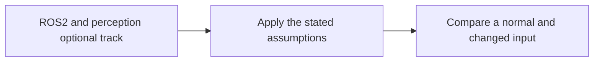

# A19.31 · ROS2 and perception optional track

[A19.30](A19.30.md) · Principal · [Exit gate](../README.md#practice-and-exit-gate)

## Problem

Messages arrive but a perception subscriber sees stale data.

## Mechanism

ROS 2 nodes exchange typed data and QoS profiles affect compatibility, delivery and queueing. Lifecycle transitions and timestamp checks define operational behavior.



## Worked example

A message aged 150 ms exceeds a 100 ms consumer deadline in this fixture.

Read the [executable calculation](../examples/A19.31.py) after predicting both outcomes.

```sh
uv run --locked python "01-architecture-A01-to-A20/A19-voice-multimodal-edge-embedded-ai/examples/A19.31.py"
uv run --locked python "01-architecture-A01-to-A20/A19-voice-multimodal-edge-embedded-ai/examples/A19.31.py" --break
```

Expected outputs are `False` and `True` respectively. Record the changed input, formula or invariant and restore the original control.

## Check your reasoning

1. What assumption is violated in the opening problem?
2. Compute the first result without running the file.
3. Identify the first observable difference in the alternate run.
4. State one change to the input that would exercise the boundary more sharply.
5. What determines compatibility between a publisher and subscriber QoS?

<details>
<summary>Feedback</summary>

Compare the opening failure with the mechanism above. The observed results are `False` and `True`. Check the derivation against the worked example. For your additional boundary case, write the expected behavior before executing it. For the transfer question, name the policy, invariant or measurable assumption the decision depends on and identify evidence that would falsify it.

</details>

Compare the first decisive intermediate observation before changing the fixture. Use [L4](../labs/L4.md) for phase-level practice.

## Primary source

- [Reference for ROS2 and perception optional track](https://github.com/ros2/ros2_documentation/blob/rolling/source/ROS-Framework/interfaces/topics/About-Quality-of-Service-Settings.rst)
