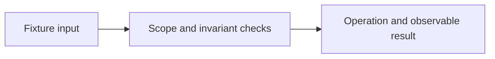

# A19 · Local voice activity and streaming prototype

[Phase index](../../README.md)

Frame an in-memory normalized waveform in arbitrary chunks and compare RMS-based voiced-state transitions under different thresholds. Ground truth in the lab is synthetic.

## Architecture

## Acceptance evidence

- [L1](../../labs/L1.md). Record frame decisions and distinguish pending from silent frames.
- [L2](../../labs/L2.md). Record false activity and use a labeled corpus before changing a production threshold.

Run the verification commands from the linked labs. Inspect the [guided source](guided.py) after predicting the outcome.
