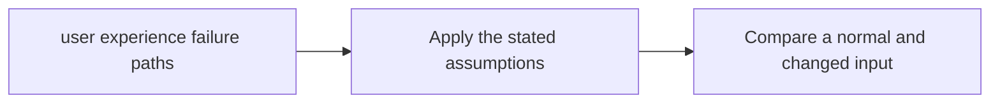

# A20.07 · user experience failure paths

[A20.06](A20.06.md) · Foundation · [A20.08](A20.08.md)

## Problem

A failed integration offers no action the user can take.

## Mechanism

Design recovery states with specific reasons, next actions and ownership. Test accessibility and timeout paths with representative users.



## Worked example

Three non-happy paths exist, error states cover two, so one remains.

Read the [executable calculation](../examples/A20.07.py) after predicting both outcomes.

```sh
uv run --locked python "01-architecture-A01-to-A20/A20-forward-deployed-product-leadership/examples/A20.07.py"
uv run --locked python "01-architecture-A01-to-A20/A20-forward-deployed-product-leadership/examples/A20.07.py" --break
```

Expected outputs are `1` and `0` respectively. Record the changed input, formula or invariant and restore the original control.

## Check your reasoning

1. What assumption is violated in the opening problem?
2. Compute the first result without running the file.
3. Identify the first observable difference in the alternate run.
4. State one change to the input that would exercise the boundary more sharply.
5. How does the user recover when retry may repeat the effect?

<details>
<summary>Feedback</summary>

Compare the opening failure with the mechanism above. The observed results are `1` and `0`. Check the derivation against the worked example. For your additional boundary case, write the expected behavior before executing it. For the transfer question, name the policy, invariant or measurable assumption the decision depends on and identify evidence that would falsify it.

</details>

Compare the first decisive intermediate observation before changing the fixture. Use [L1](../labs/L1.md) for phase-level practice.

## Primary source

- [Reference for user experience failure paths](https://www.gov.uk/service-manual/user-research/user-research-in-discovery)
