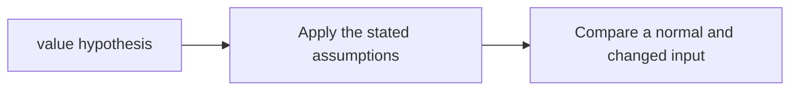

# A20.08 · value hypothesis

[A20.07](A20.07.md) · Core · [A20.09](A20.09.md)

## Problem

A project claims value with no falsifiable hypothesis.

## Mechanism

Propose an outcome, audience, baseline and time horizon with a guardrail. Define what evidence would reject the hypothesis.



## Worked example

Baseline yield 60/100 and candidate 70/100 gives 10 percentage points, below a 12-point success target.

Read the [executable calculation](../examples/A20.08.py) after predicting both outcomes.

```sh
uv run --locked python "01-architecture-A01-to-A20/A20-forward-deployed-product-leadership/examples/A20.08.py"
uv run --locked python "01-architecture-A01-to-A20/A20-forward-deployed-product-leadership/examples/A20.08.py" --break
```

Expected outputs are `False` and `True` respectively. Record the changed input, formula or invariant and restore the original control.

## Check your reasoning

1. What assumption is violated in the opening problem?
2. Compute the first result without running the file.
3. Identify the first observable difference in the alternate run.
4. State one change to the input that would exercise the boundary more sharply.
5. What could explain the change without the intervention?

<details>
<summary>Feedback</summary>

Compare the opening failure with the mechanism above. The observed results are `False` and `True`. Check the derivation against the worked example. For your additional boundary case, write the expected behavior before executing it. For the transfer question, name the policy, invariant or measurable assumption the decision depends on and identify evidence that would falsify it.

</details>

Compare the first decisive intermediate observation before changing the fixture. Use [L1](../labs/L1.md) for phase-level practice.

## Primary source

- [Reference for value hypothesis](https://www.gov.uk/service-manual/user-research/user-research-in-discovery)
