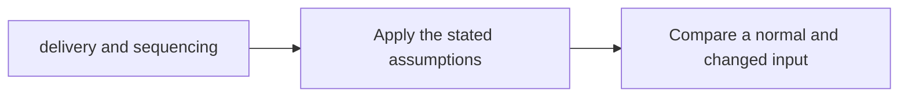

# A20.16 · delivery and sequencing

[A20.15](A20.15.md) · Core · [A20.17](A20.17.md)

## Problem

Parallel work starts before prerequisites exist.

## Mechanism

Model dependency ordering, unblock irreversible bottlenecks early, and bound work in progress. Verify the critical path through serial and parallel work.



## Worked example

Two parallel tasks take 4 and 7 days then a 3-day integration. Critical path is 10, not 14.

Read the [executable calculation](../examples/A20.16.py) after predicting both outcomes.

```sh
uv run --locked python "01-architecture-A01-to-A20/A20-forward-deployed-product-leadership/examples/A20.16.py"
uv run --locked python "01-architecture-A01-to-A20/A20-forward-deployed-product-leadership/examples/A20.16.py" --break
```

Expected outputs are `10` and `14` respectively. Record the changed input, formula or invariant and restore the original control.

## Check your reasoning

1. What assumption is violated in the opening problem?
2. Compute the first result without running the file.
3. Identify the first observable difference in the alternate run.
4. State one change to the input that would exercise the boundary more sharply.
5. What changes if both tasks need the same engineer?

<details>
<summary>Feedback</summary>

Compare the opening failure with the mechanism above. The observed results are `10` and `14`. Check the derivation against the worked example. For your additional boundary case, write the expected behavior before executing it. For the transfer question, name the policy, invariant or measurable assumption the decision depends on and identify evidence that would falsify it.

</details>

Compare the first decisive intermediate observation before changing the fixture. Use [L3](../labs/L3.md) for phase-level practice.

## Primary source

- [Reference for delivery and sequencing](https://kanbanguides.org/)
