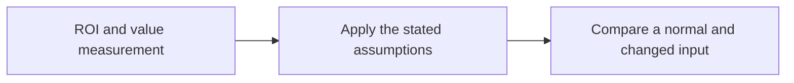

# A20.26 · ROI and value measurement

[A20.25](A20.25.md) · Principal · [A20.27](A20.27.md)

## Problem

Savings are computed without migration and run costs.

## Mechanism

Estimate benefits against baseline and include recurring cost, one-time cost and uncertainty. Define payback and ROI denominator.



## Worked example

Benefits 150 and total costs 100 yield net 50 and simple ROI 0.5.

Read the [executable calculation](../examples/A20.26.py) after predicting both outcomes.

```sh
uv run --locked python "01-architecture-A01-to-A20/A20-forward-deployed-product-leadership/examples/A20.26.py"
uv run --locked python "01-architecture-A01-to-A20/A20-forward-deployed-product-leadership/examples/A20.26.py" --break
```

Expected outputs are `0.5` and `1.5` respectively. Record the changed input, formula or invariant and restore the original control.

## Check your reasoning

1. What assumption is violated in the opening problem?
2. Compute the first result without running the file.
3. Identify the first observable difference in the alternate run.
4. State one change to the input that would exercise the boundary more sharply.
5. Which benefits may double-count the same labor reduction?

<details>
<summary>Feedback</summary>

Compare the opening failure with the mechanism above. The observed results are `0.5` and `1.5`. Check the derivation against the worked example. For your additional boundary case, write the expected behavior before executing it. For the transfer question, name the policy, invariant or measurable assumption the decision depends on and identify evidence that would falsify it.

</details>

Compare the first decisive intermediate observation before changing the fixture. Use [L4](../labs/L4.md) for phase-level practice.

## Primary source

- [Reference for ROI and value measurement](https://www.finops.org/framework/capabilities/unit-economics/)
