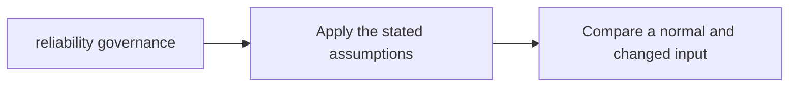

# A20.27 · reliability governance

[A20.26](A20.26.md) · Principal · [A20.28](A20.28.md)

## Problem

Teams track error rates but never act on budget depletion.

## Mechanism

Assign service-level ownership, release rules and incident review. Express burn as observed bad fraction divided by target bad fraction.



## Worked example

At allowed bad rate 0.001, observed 0.002 gives 2x burn.

Read the [executable calculation](../examples/A20.27.py) after predicting both outcomes.

```sh
uv run --locked python "01-architecture-A01-to-A20/A20-forward-deployed-product-leadership/examples/A20.27.py"
uv run --locked python "01-architecture-A01-to-A20/A20-forward-deployed-product-leadership/examples/A20.27.py" --break
```

Expected outputs are `2.0` and `0.002` respectively. Record the changed input, formula or invariant and restore the original control.

## Check your reasoning

1. What assumption is violated in the opening problem?
2. Compute the first result without running the file.
3. Identify the first observable difference in the alternate run.
4. State one change to the input that would exercise the boundary more sharply.
5. What change in window would alter the alert meaning?

<details>
<summary>Feedback</summary>

Compare the opening failure with the mechanism above. The observed results are `2.0` and `0.002`. Check the derivation against the worked example. For your additional boundary case, write the expected behavior before executing it. For the transfer question, name the policy, invariant or measurable assumption the decision depends on and identify evidence that would falsify it.

</details>

Compare the first decisive intermediate observation before changing the fixture. Use [L4](../labs/L4.md) for phase-level practice.

## Primary source

- [Reference for reliability governance](https://sre.google/workbook/index/)
