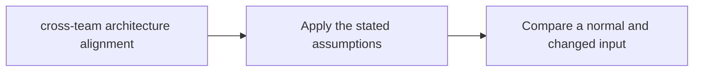

# A20.30 · cross-team architecture alignment

[A20.29](A20.29.md) · Principal · [Exit gate](../README.md#practice-and-exit-gate)

## Problem

Multiple teams adopt incompatible API contracts.

## Mechanism

Document shared invariants, owners and evolution. Use end-to-end contract evidence and track exceptions.



## Worked example

Three integrations require revision 2. Two meet it and one needs change.

Read the [executable calculation](../examples/A20.30.py) after predicting both outcomes.

```sh
uv run --locked python "01-architecture-A01-to-A20/A20-forward-deployed-product-leadership/examples/A20.30.py"
uv run --locked python "01-architecture-A01-to-A20/A20-forward-deployed-product-leadership/examples/A20.30.py" --break
```

Expected outputs are `1` and `0` respectively. Record the changed input, formula or invariant and restore the original control.

## Check your reasoning

1. What assumption is violated in the opening problem?
2. Compute the first result without running the file.
3. Identify the first observable difference in the alternate run.
4. State one change to the input that would exercise the boundary more sharply.
5. What is the smallest change that restores compatibility?

<details>
<summary>Feedback</summary>

Compare the opening failure with the mechanism above. The observed results are `1` and `0`. Check the derivation against the worked example. For your additional boundary case, write the expected behavior before executing it. For the transfer question, name the policy, invariant or measurable assumption the decision depends on and identify evidence that would falsify it.

</details>

Compare the first decisive intermediate observation before changing the fixture. Use [L4](../labs/L4.md) for phase-level practice.

## Primary source

- [Reference for cross-team architecture alignment](https://docs.cloud.google.com/architecture/architecture-decision-records)
