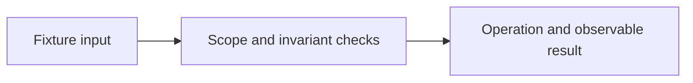

# A20 · Forward-deployed product from discovery through operations

[Phase index](../../README.md)

Deliver a synthetic versioned customer-environment pilot with preflight evidence, outcome gate and restoration to a preserved baseline.

## Architecture

## Acceptance evidence

- [L3](../../labs/L3.md). Record hold or promotion, and preserve the stable deployment.
- [L4](../../labs/L4.md). Record baseline restoration and attach the event to the delivery decision.

Run the verification commands from the linked labs. Inspect the [independent source](independent.py) after predicting the outcome.

Attempt an independent implementation and preserve normal and failure results before consulting the reference. Repeat with a counterexample from a different input family.
