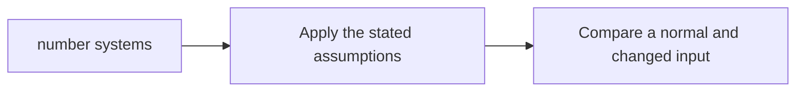

# M01.01 · number systems

[Phase index](../README.md) · Foundation · [M01.02](M01.02.md)

## Problem

Taking square roots can leave the declared number system.

## Mechanism

Integers are closed under addition and multiplication; division can require rationals. The real numbers include irrationals, and complex numbers extend the reals with i²=−1.



## Worked example

3/2 is rational and not an integer. Seeking a real solution to x²=−1 yields none; i is a complex solution.

Read the [executable calculation](../examples/M01.01.py) after predicting both outcomes.

```sh
uv run --locked python "02-mathematics-M01-to-M13/M01-sets-and-mathematical-language/examples/M01.01.py"
uv run --locked python "02-mathematics-M01-to-M13/M01-sets-and-mathematical-language/examples/M01.01.py" --break
```

Expected outputs are `(1.5, (-1+0j))` and `(1, 1)` respectively. Record the changed input, formula or invariant and restore the original control.

## Check your reasoning

1. What assumption is violated in the opening problem?
2. Compute the first result without running the file.
3. Identify the first observable difference in the alternate run.
4. State one change to the input that would exercise the boundary more sharply.
5. Which closure property fails for subtraction on nonnegative integers?

<details>
<summary>Feedback</summary>

Compare the opening failure with the mechanism above. The observed results are `(1.5, (-1+0j))` and `(1, 1)`. Check the derivation against the worked example. For your additional boundary case, write the expected behavior before executing it. For the transfer question, name the policy, invariant or measurable assumption the decision depends on and identify evidence that would falsify it.

</details>

Complete the [numerical problem set](../drills/M01.01.md). Use [L1](../labs/L1.md) for phase-level practice.

## Primary source

- [Reference for number systems](https://ocw.mit.edu/courses/6-1200j-mathematics-for-computer-science-spring-2024/pages/readings/)
