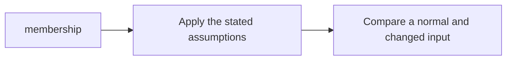

# M01.03 · membership

[M01.02](M01.02.md) · Foundation · [M01.04](M01.04.md)

## Problem

A collection element is confused with a set contained in it.

## Mechanism

Membership tests whether an object is an element. Subset tests whether every element of one set belongs to the other. Empty set is a subset of every set.



## Worked example

For A={1,2}, 1∈A and {1}⊆A. A does not contain the singleton set as an element.

Read the [executable calculation](../examples/M01.03.py) after predicting both outcomes.

```sh
uv run --locked python "02-mathematics-M01-to-M13/M01-sets-and-mathematical-language/examples/M01.03.py"
uv run --locked python "02-mathematics-M01-to-M13/M01-sets-and-mathematical-language/examples/M01.03.py" --break
```

Expected outputs are `(True, True)` and `(False, False)` respectively. Record the changed input, formula or invariant and restore the original control.

## Check your reasoning

1. What assumption is violated in the opening problem?
2. Compute the first result without running the file.
3. Identify the first observable difference in the alternate run.
4. State one change to the input that would exercise the boundary more sharply.
5. How can a set itself appear as an element?

<details>
<summary>Feedback</summary>

Compare the opening failure with the mechanism above. The observed results are `(True, True)` and `(False, False)`. Check the derivation against the worked example. For your additional boundary case, write the expected behavior before executing it. For the transfer question, name the policy, invariant or measurable assumption the decision depends on and identify evidence that would falsify it.

</details>

Complete the [numerical problem set](../drills/M01.03.md). Use [L2](../labs/L2.md) for phase-level practice.

## Primary source

- [Reference for membership](https://ocw.mit.edu/courses/6-1200j-mathematics-for-computer-science-spring-2024/pages/readings/)
