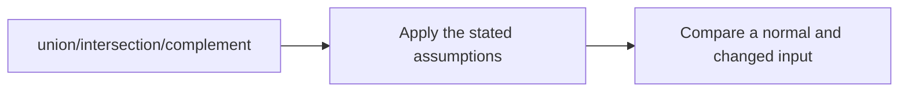

# M01.05 · union/intersection/complement

[M01.04](M01.04.md) · Foundation · [M01.06](M01.06.md)

## Problem

Complement is computed without a universe.

## Mechanism

Union accepts either set, intersection requires both, and complement means U minus A for a declared universe U. De Morgan laws follow decision-by-decision.



## Worked example

U={0,1,2,3}, A={0,1}, B={1,2}; union has size 3, intersection size 1, complement of union size 1.

Read the [executable calculation](../examples/M01.05.py) after predicting both outcomes.

```sh
uv run --locked python "02-mathematics-M01-to-M13/M01-sets-and-mathematical-language/examples/M01.05.py"
uv run --locked python "02-mathematics-M01-to-M13/M01-sets-and-mathematical-language/examples/M01.05.py" --break
```

Expected outputs are `(3, 1, 1)` and `(2, 2, 2)` respectively. Record the changed input, formula or invariant and restore the original control.

## Check your reasoning

1. What assumption is violated in the opening problem?
2. Compute the first result without running the file.
3. Identify the first observable difference in the alternate run.
4. State one change to the input that would exercise the boundary more sharply.
5. Show the complement of the union equals the intersection of complements.

<details>
<summary>Feedback</summary>

Compare the opening failure with the mechanism above. The observed results are `(3, 1, 1)` and `(2, 2, 2)`. Check the derivation against the worked example. For your additional boundary case, write the expected behavior before executing it. For the transfer question, name the policy, invariant or measurable assumption the decision depends on and identify evidence that would falsify it.

</details>

Complete the [numerical problem set](../drills/M01.05.md). Use [L3](../labs/L3.md) for phase-level practice.

## Primary source

- [Reference for union/intersection/complement](https://ocw.mit.edu/courses/6-1200j-mathematics-for-computer-science-spring-2024/pages/readings/)
