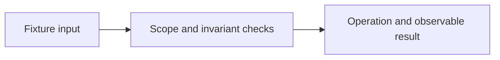

# M01 · Independent calculation and ML transfer

[Phase index](../../README.md)

Use indicator sets to select a model-error cohort and compute a weighted estimate. Exercise shape, zero denominators and the consequences of weighted sampling.

## Architecture

## Acceptance evidence

- [L4](../../labs/L4.md). Record the ordinary result and explain why a zero-weight denominator is invalid.

Run the verification commands from the linked labs. Inspect the [independent source](independent.py) after predicting the outcome.

Attempt an independent implementation and preserve normal and failure results before consulting the reference. Repeat with a counterexample from a different input family.

Work the [worksheet](WORKSHEET.md), then verify it using the [NumPy notebook](verify.ipynb) in an environment with the math extra.
