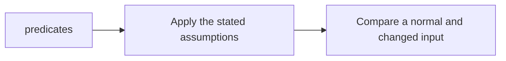

# M02.02 · predicates

[M02.01](M02.01.md) · Foundation · [M02.03](M02.03.md)

## Problem

One observed case is promoted to a universal predicate.

## Mechanism

A predicate assigns a truth value to each eligible tuple. Keep domain, arity and interpretation explicit.



## Worked example

Even over inputs 1,2,3,4 selects 2 and 4.

Read the [executable calculation](../examples/M02.02.py) after predicting both outcomes.

```sh
uv run --locked python "02-mathematics-M01-to-M13/M02-logic-and-proof/examples/M02.02.py"
uv run --locked python "02-mathematics-M01-to-M13/M02-logic-and-proof/examples/M02.02.py" --break
```

Expected outputs are `[2, 4]` and `[2]` respectively. Record the changed input, formula or invariant and restore the original control.

## Check your reasoning

1. What assumption is violated in the opening problem?
2. Compute the first result without running the file.
3. Identify the first observable difference in the alternate run.
4. State one change to the input that would exercise the boundary more sharply.
5. How does restricting the domain change universal conclusions?

<details>
<summary>Feedback</summary>

Compare the opening failure with the mechanism above. The observed results are `[2, 4]` and `[2]`. Check the derivation against the worked example. For your additional boundary case, write the expected behavior before executing it. For the transfer question, name the policy, invariant or measurable assumption the decision depends on and identify evidence that would falsify it.

</details>

Complete the [numerical problem set](../drills/M02.02.md). Use [L1](../labs/L1.md) for phase-level practice.

## Primary source

- [Reference for predicates](https://ocw.mit.edu/courses/6-1200j-mathematics-for-computer-science-spring-2024/pages/readings/)
