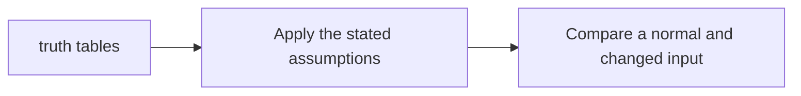

# M02.03 · truth tables

[M02.02](M02.02.md) · Foundation · [M02.04](M02.04.md)

## Problem

An OR is accidentally implemented as exclusive OR.

## Mechanism

Enumerate boolean inputs to derive a truth table. Inclusive OR holds when either or both inputs are true; XOR holds for unequal truth values.



## Worked example

OR over FF,FT,TF,TT yields 0,1,1,1 versus XOR 0,1,1,0.

Read the [executable calculation](../examples/M02.03.py) after predicting both outcomes.

```sh
uv run --locked python "02-mathematics-M01-to-M13/M02-logic-and-proof/examples/M02.03.py"
uv run --locked python "02-mathematics-M01-to-M13/M02-logic-and-proof/examples/M02.03.py" --break
```

Expected outputs are `[0, 1, 1, 1]` and `[0, 1, 1, 0]` respectively. Record the changed input, formula or invariant and restore the original control.

## Check your reasoning

1. What assumption is violated in the opening problem?
2. Compute the first result without running the file.
3. Identify the first observable difference in the alternate run.
4. State one change to the input that would exercise the boundary more sharply.
5. Which row distinguishes inclusive and exclusive OR?

<details>
<summary>Feedback</summary>

Compare the opening failure with the mechanism above. The observed results are `[0, 1, 1, 1]` and `[0, 1, 1, 0]`. Check the derivation against the worked example. For your additional boundary case, write the expected behavior before executing it. For the transfer question, name the policy, invariant or measurable assumption the decision depends on and identify evidence that would falsify it.

</details>

Complete the [numerical problem set](../drills/M02.03.md). Use [L2](../labs/L2.md) for phase-level practice.

## Primary source

- [Reference for truth tables](https://ocw.mit.edu/courses/6-1200j-mathematics-for-computer-science-spring-2024/pages/readings/)
