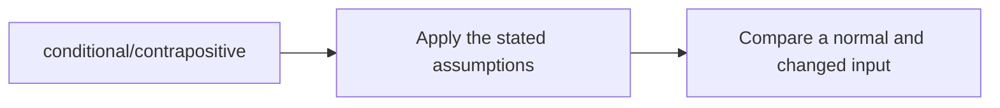

# M02.04 · conditional/contrapositive

[M02.03](M02.03.md) · Foundation · [M02.05](M02.05.md)

## Problem

A proof assumes the converse of a conditional.

## Mechanism

P→Q is false only for P true and Q false. It is equivalent to ¬Q→¬P; the converse Q→P need not be equivalent.



## Worked example

For P false and Q true the original and contrapositive are true, and the converse is false.

Read the [executable calculation](../examples/M02.04.py) after predicting both outcomes.

```sh
uv run --locked python "02-mathematics-M01-to-M13/M02-logic-and-proof/examples/M02.04.py"
uv run --locked python "02-mathematics-M01-to-M13/M02-logic-and-proof/examples/M02.04.py" --break
```

Expected outputs are `(True, True)` and `False` respectively. Record the changed input, formula or invariant and restore the original control.

## Check your reasoning

1. What assumption is violated in the opening problem?
2. Compute the first result without running the file.
3. Identify the first observable difference in the alternate run.
4. State one change to the input that would exercise the boundary more sharply.
5. Why can a false antecedent make a conditional true?

<details>
<summary>Feedback</summary>

Compare the opening failure with the mechanism above. The observed results are `(True, True)` and `False`. Check the derivation against the worked example. For your additional boundary case, write the expected behavior before executing it. For the transfer question, name the policy, invariant or measurable assumption the decision depends on and identify evidence that would falsify it.

</details>

Complete the [numerical problem set](../drills/M02.04.md). Use [L2](../labs/L2.md) for phase-level practice.

## Primary source

- [Reference for conditional/contrapositive](https://ocw.mit.edu/courses/6-1200j-mathematics-for-computer-science-spring-2024/pages/readings/)
