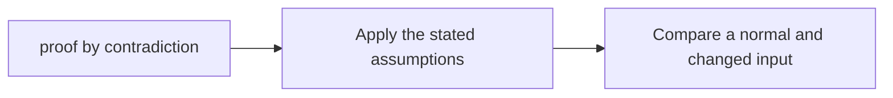

# M02.07 · proof by contradiction

[M02.06](M02.06.md) · Foundation · [M02.08](M02.08.md)

## Problem

A proof searches examples instead of deriving impossibility.

## Mechanism

For contradiction, assume the negation of the goal and derive incompatible facts within the premises. For a counterexample, one valid witness refutes a universal claim.



## Worked example

Two odd integers have form 2k+1 and 2j+1. With k=1,j=2 their sum is 8 and remainder modulo 2 is zero.

Read the [executable calculation](../examples/M02.07.py) after predicting both outcomes.

```sh
uv run --locked python "02-mathematics-M01-to-M13/M02-logic-and-proof/examples/M02.07.py"
uv run --locked python "02-mathematics-M01-to-M13/M02-logic-and-proof/examples/M02.07.py" --break
```

Expected outputs are `0` and `1` respectively. Record the changed input, formula or invariant and restore the original control.

## Check your reasoning

1. What assumption is violated in the opening problem?
2. Compute the first result without running the file.
3. Identify the first observable difference in the alternate run.
4. State one change to the input that would exercise the boundary more sharply.
5. How does the algebra generalize without enumerating inputs?

<details>
<summary>Feedback</summary>

Compare the opening failure with the mechanism above. The observed results are `0` and `1`. Check the derivation against the worked example. For your additional boundary case, write the expected behavior before executing it. For the transfer question, name the policy, invariant or measurable assumption the decision depends on and identify evidence that would falsify it.

</details>

Complete the [numerical problem set](../drills/M02.07.md). Use [L4](../labs/L4.md) for phase-level practice.

## Primary source

- [Reference for proof by contradiction](https://ocw.mit.edu/courses/6-1200j-mathematics-for-computer-science-spring-2024/pages/readings/)
