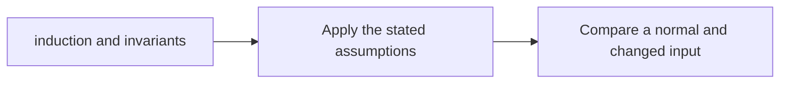

# M02.08 · induction and invariants

[M02.07](M02.07.md) · Foundation · [Exit gate](../README.md#practice-and-exit-gate)

## Problem

An induction proves the transition but skips initialization.

## Mechanism

Identify induction domain and base case, then prove the property is preserved by each transition. A loop invariant also needs to imply the desired result on termination.



## Worked example

Invariant sum of first n integers is n(n+1)/2. For n=4 compare 10 with the invalid n(n−1)/2=6.

Read the [executable calculation](../examples/M02.08.py) after predicting both outcomes.

```sh
uv run --locked python "02-mathematics-M01-to-M13/M02-logic-and-proof/examples/M02.08.py"
uv run --locked python "02-mathematics-M01-to-M13/M02-logic-and-proof/examples/M02.08.py" --break
```

Expected outputs are `10` and `6` respectively. Record the changed input, formula or invariant and restore the original control.

## Check your reasoning

1. What assumption is violated in the opening problem?
2. Compute the first result without running the file.
3. Identify the first observable difference in the alternate run.
4. State one change to the input that would exercise the boundary more sharply.
5. Which step relates a loop invariant to its postcondition?

<details>
<summary>Feedback</summary>

Compare the opening failure with the mechanism above. The observed results are `10` and `6`. Check the derivation against the worked example. For your additional boundary case, write the expected behavior before executing it. For the transfer question, name the policy, invariant or measurable assumption the decision depends on and identify evidence that would falsify it.

</details>

Complete the [numerical problem set](../drills/M02.08.md). Use [L4](../labs/L4.md) for phase-level practice.

## Primary source

- [Reference for induction and invariants](https://ocw.mit.edu/courses/6-1200j-mathematics-for-computer-science-spring-2024/pages/readings/)
