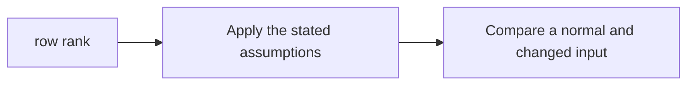

# M03.04 · row rank

[M03.03](M03.03.md) · Foundation · [M03.05](M03.05.md)

## Problem

The row count is mistaken for row rank.

## Mechanism

Row rank is the dimension of row space. Count pivots after elimination, applying a declared tolerance in floating point.



## Worked example

Rows [1,2],[2,4] are dependent. Subtracting twice the first from the second gives [0,0] and rank one.

Read the [executable calculation](../examples/M03.04.py) after predicting both outcomes.

```sh
uv run --locked python "02-mathematics-M01-to-M13/M03-linear-systems/examples/M03.04.py"
uv run --locked python "02-mathematics-M01-to-M13/M03-linear-systems/examples/M03.04.py" --break
```

Expected outputs are `1` and `2` respectively. Record the changed input, formula or invariant and restore the original control.

## Check your reasoning

1. What assumption is violated in the opening problem?
2. Compute the first result without running the file.
3. Identify the first observable difference in the alternate run.
4. State one change to the input that would exercise the boundary more sharply.
5. How could small noise affect a numerical rank estimate?

<details>
<summary>Feedback</summary>

Compare the opening failure with the mechanism above. The observed results are `1` and `2`. Check the derivation against the worked example. For your additional boundary case, write the expected behavior before executing it. For the transfer question, name the policy, invariant or measurable assumption the decision depends on and identify evidence that would falsify it.

</details>

Complete the [numerical problem set](../drills/M03.04.md). Use [L2](../labs/L2.md) for phase-level practice.

## Primary source

- [Reference for row rank](https://ocw.mit.edu/courses/18-06-linear-algebra-spring-2010/)
