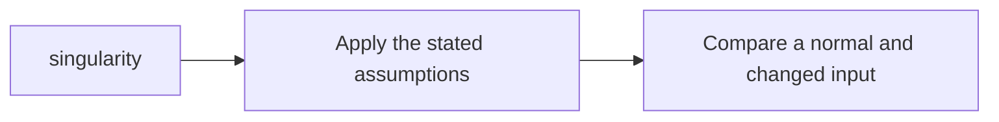

# M03.06 · singularity

[M03.05](M03.05.md) · Foundation · [M03.07](M03.07.md)

## Problem

A solver assumes every square matrix has an inverse.

## Mechanism

In a square system a zero pivot after suitable row selection signals singularity. Compare augmented rank with coefficient rank to distinguish infinitely many exact solutions from none.



## Worked example

Rows [1,1] and [2,2] imply second right-hand entry must be twice the first. For b=(3,7) the residual constraint is 1.

Read the [executable calculation](../examples/M03.06.py) after predicting both outcomes.

```sh
uv run --locked python "02-mathematics-M01-to-M13/M03-linear-systems/examples/M03.06.py"
uv run --locked python "02-mathematics-M01-to-M13/M03-linear-systems/examples/M03.06.py" --break
```

Expected outputs are `1` and `0` respectively. Record the changed input, formula or invariant and restore the original control.

## Check your reasoning

1. What assumption is violated in the opening problem?
2. Compute the first result without running the file.
3. Identify the first observable difference in the alternate run.
4. State one change to the input that would exercise the boundary more sharply.
5. What information separates inconsistent from underdetermined systems?

<details>
<summary>Feedback</summary>

Compare the opening failure with the mechanism above. The observed results are `1` and `0`. Check the derivation against the worked example. For your additional boundary case, write the expected behavior before executing it. For the transfer question, name the policy, invariant or measurable assumption the decision depends on and identify evidence that would falsify it.

</details>

Complete the [numerical problem set](../drills/M03.06.md). Use [L3](../labs/L3.md) for phase-level practice.

## Primary source

- [Reference for singularity](https://ocw.mit.edu/courses/18-06-linear-algebra-spring-2010/)
