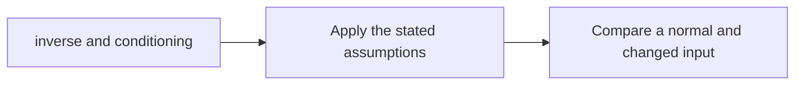

# M03.07 · inverse and conditioning

[M03.06](M03.06.md) · Foundation · [Exit gate](../README.md#practice-and-exit-gate)

## Problem

A tiny residual is advertised as guaranteed accurate recovery.

## Mechanism

In compatible norms the matrix condition number relates input perturbation to worst-case relative output amplification. Prefer a direct linear solve to explicit inverse for one system.



## Worked example

For diagonal entries 1,0.001, two-norm condition number is 1000. Replacing second by 0.1 gives 10.

Read the [executable calculation](../examples/M03.07.py) after predicting both outcomes.

```sh
uv run --locked python "02-mathematics-M01-to-M13/M03-linear-systems/examples/M03.07.py"
uv run --locked python "02-mathematics-M01-to-M13/M03-linear-systems/examples/M03.07.py" --break
```

Expected outputs are `1000.0` and `10.0` respectively. Record the changed input, formula or invariant and restore the original control.

## Check your reasoning

1. What assumption is violated in the opening problem?
2. Compute the first result without running the file.
3. Identify the first observable difference in the alternate run.
4. State one change to the input that would exercise the boundary more sharply.
5. Why is a well-scaled right-hand side insufficient to guarantee conditioning?

<details>
<summary>Feedback</summary>

Compare the opening failure with the mechanism above. The observed results are `1000.0` and `10.0`. Check the derivation against the worked example. For your additional boundary case, write the expected behavior before executing it. For the transfer question, name the policy, invariant or measurable assumption the decision depends on and identify evidence that would falsify it.

</details>

Complete the [numerical problem set](../drills/M03.07.md). Use [L4](../labs/L4.md) for phase-level practice.

## Primary source

- [Reference for inverse and conditioning](https://ocw.mit.edu/courses/18-06-linear-algebra-spring-2010/)
