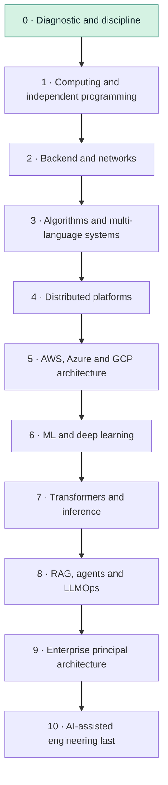

# Principal Engineering Mastery


**Understand → Calculate → Implement → Break → Repair → Rebuild → Teach → Retain**

A practice-first curriculum for software, cloud and AI systems. Start with a diagnostic, then connect program behavior to OS evidence. Each A01–A20 lesson includes a trace, a runnable example, and a controlled alternative.

| Start here | What you'll do |
| --- | --- |
| [Stage 0 diagnosis](00-stage-0-diagnostic/README.md) | Check five prerequisite skills and log gaps |
| [A01 systems and OS](01-architecture-A01-to-A20/A01-computer-systems-and-os/README.md) | Work through 36 lessons, four labs and two projects |
| [A02 networking](01-architecture-A01-to-A20/A02-networking-and-communication/README.md) | Trace requests through DNS, transport, TLS and HTTP |
| [A03 Python runtime and backend APIs](01-architecture-A01-to-A20/A03-python-runtime-and-backend-apis/README.md) | Trace execution, concurrency and API behavior |
| [A04 databases and storage](01-architecture-A01-to-A20/A04-databases-sql-and-storage-engines/README.md) | Diagnose SQL plans, transactions and recovery |
| [A05 scalability and performance](01-architecture-A01-to-A20/A05-scalability-caching-performance/README.md) | Estimate capacity and test cache, queue and admission behavior |
| [A06 distributed systems](01-architecture-A01-to-A20/A06-distributed-systems-coordination/README.md) | Trace partitions, quorum, retries and fencing |
| [A07 application integration](01-architecture-A01-to-A20/A07-application-integration-arch/README.md) | Verify contracts, queues, sagas and outbox replay |
| [A08 reliability and SRE](01-architecture-A01-to-A20/A08-reliability-operations-and-sre/README.md) | Measure reliability and rehearse fault recovery |
| [A09 Cloud, Containers, Kubernetes & Platform Engineering](01-architecture-A01-to-A20/A09-cloud-containers-k8s-devsecops/README.md) | Build and troubleshoot containerized Kubernetes workloads |
| [A10 ML Foundations, AI Math & MLOps](01-architecture-A01-to-A20/A10-ml-foundations-math-and-mlops/README.md) | Verify gradients, data boundaries, and model artifacts |
| [A11 Transformers, LLM Internals & Inference](01-architecture-A01-to-A20/A11-transformers-llm-internals/README.md) | Measure causal attention, cache footprints, and decoding |
| [A12 Search, RAG & Knowledge Systems](01-architecture-A01-to-A20/A12-search-rag-and-knowledge-systems/README.md) | Compare retrieval rankings and enforce tenant boundaries |
| [A13 Agentic AI, MCP & Workflow Orchestration](01-architecture-A01-to-A20/A13-agentic-ai-mcp-orchestration/README.md) | Verify workflow state, approval, and replay-safe effects |
| [A14 Advanced LLMOps, Evaluation & Safety](01-architecture-A01-to-A20/A14-advanced-llmops-evals-safety/README.md) | Evaluate model releases and rehearse canary rollback |
| [A15 Security, Privacy & Global-Scale Architecture](01-architecture-A01-to-A20/A15-security-privacy-global-scale/README.md) | Test identity, artifact integrity and tenant isolation |
| [A16 System Design & Product-Company Interviews](01-architecture-A01-to-A20/A16-system-design-and-interviews/README.md) | Quantify system designs and preserve transactional invariants |
| [A17 Regulated AI: Compliance, Safety & Governance](01-architecture-A01-to-A20/A17-regulated-ai-compliance-governance/README.md) | Verify review, evidence and audit boundaries in regulated workflows |
| [A18 Microsoft Foundry & Enterprise AI Platforms](01-architecture-A01-to-A20/A18-microsoft-foundry-enterprise-ai/README.md) | Compare cloud platform choices with mock tenancy, quota and routing controls |
| [A19 Voice, Multimodal, Edge & Embedded AI](01-architecture-A01-to-A20/A19-voice-multimodal-edge-embedded-ai/README.md) | Measure synthetic streaming audio and test offline fallback |
| [A20 Forward-Deployed Engineering, Product & Leadership](01-architecture-A01-to-A20/A20-forward-deployed-product-leadership/README.md) | Translate discovery evidence into rollout and recovery decisions |
| [M01 Sets and mathematical language](02-mathematics-M01-to-M13/M01-sets-and-mathematical-language/README.md) | Derive finite-set operations and measure cohort errors |
| [M02 Logic and proof](02-mathematics-M01-to-M13/M02-logic-and-proof/README.md) | Practice proof, quantifier order and invariants |
| [M03 Linear systems](02-mathematics-M01-to-M13/M03-linear-systems/README.md) | Solve linear systems and measure conditioning |
| [Curriculum roadmap](ROADMAP.md#curriculum-index) | Inspect later tracks and their planned scope |
| [Teaching contract](TEACHING_CONTRACT.md) | Pair with a tutor and preserve independent assessment |
| [Progress tracker](PROGRESS_TRACKER.md) | Record evidence and schedule retrieval practice |

## Five-minute quickstart

Install [uv](https://docs.astral.sh/uv/) and use Python 3.12 or later.

```sh
git clone https://github.com/chan4kum/principal-engineering-mastery.git
cd principal-engineering-mastery
uv sync --locked
uv run python 00-stage-0-diagnostic/diagnose.py
uv run --locked --all-extras pytest -q
```

Use Linux for real /proc and cgroup evidence. macOS supports the portable exercises and can run the Linux labs through a local Docker engine. The diagnostic and Phase A01 require no paid service. See the lab instructions for container limits and cleanup.

## Dependency path



Stage 1 includes A01. Stage 2 includes A02–A04. Stage 4 includes A05–A09. Stages 6–9 include A10–A20 and retain their earlier prerequisite gates. The [mathematics track](02-mathematics-M01-to-M13/README.md) has guided walkthroughs from M01 through M13. See the [roadmap](ROADMAP.md) for stage gates and the [curriculum index](ROADMAP.md#curriculum-index) for coverage by track.

### Curriculum by track

[Architecture](ROADMAP.md#architecture) · [Mathematics](ROADMAP.md#mathematics) · [DSA](ROADMAP.md#data-structures-and-algorithms) · [Inference](ROADMAP.md#inference) · [AWS, Azure and GCP](ROADMAP.md#cloud) · [Platform and enterprise](ROADMAP.md#platform-and-enterprise) · [Capstones and interviews](ROADMAP.md#capstones-and-interviews)

## How to study

Each architecture module from A01 through A20 has a **Guided walkthrough** in lesson order. Use it to follow the concepts, then open the individual lessons and labs for runnable examples and mastery evidence.

On a tablet, predict outputs and use the diagrams and collapsed answer sections. On a laptop, compare normal and failure modes and save the exact command, result and repair. Choose sessions of 15–90 minutes and work on one active concept at a time. Give your AI tutor the contract and the current tracker entry when resuming.

## Source and design

Lesson IDs and titles follow the detailed *Principal Software, Cloud & AI Complete Mastery Roadmap* and the architecture index of *Principal AI Architect Master Roadmap v3*. The supplied standalone teaching contract and combined edition inform the learner and tutor protocol.

Navigation, active recall, progressive builds and runnable projects were benchmarked against [The System Design Primer](https://github.com/donnemartin/system-design-primer), [Neural Networks: Zero to Hero](https://github.com/karpathy/nn-zero-to-hero) and [Build Your Own X](https://github.com/codecrafters-io/build-your-own-x).

[Contribute](CONTRIBUTING.md) · [License](LICENSE)
